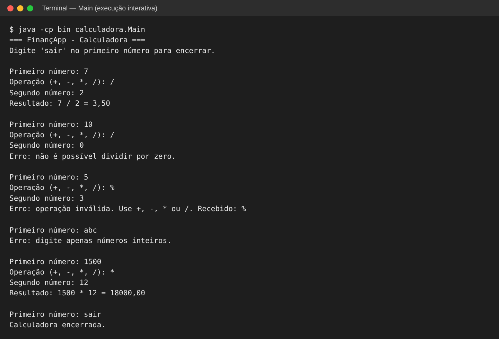
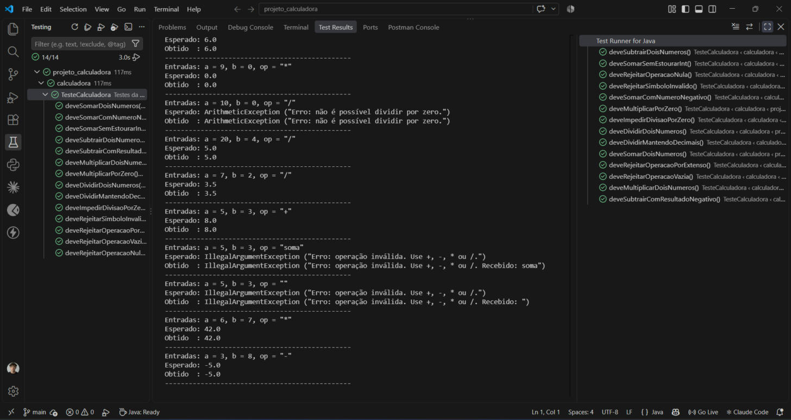
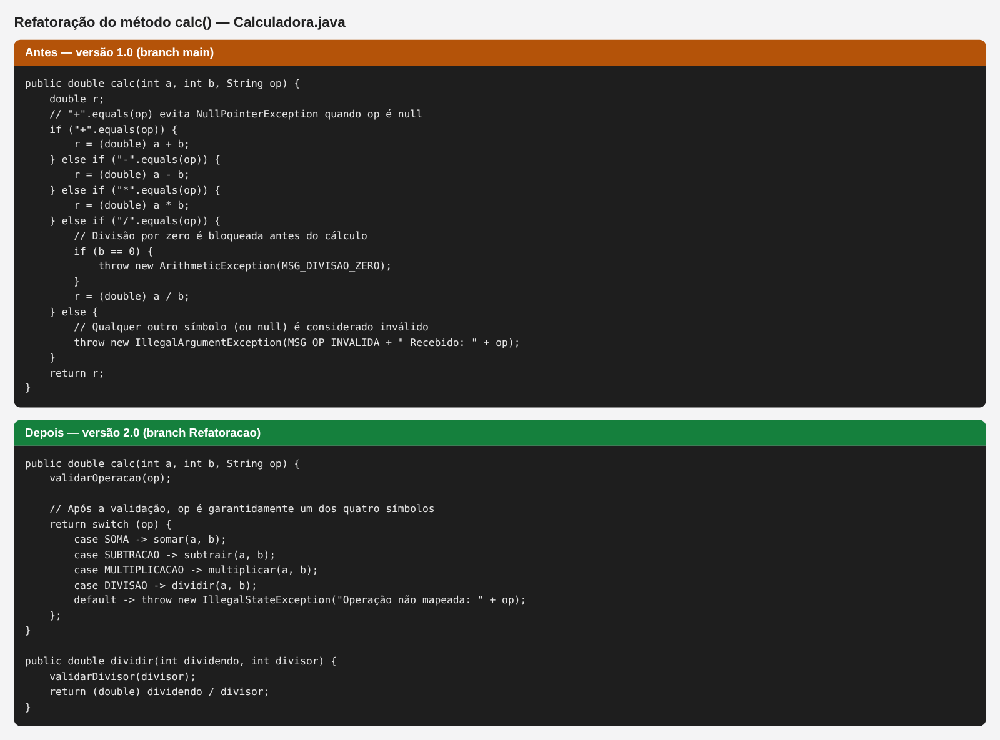
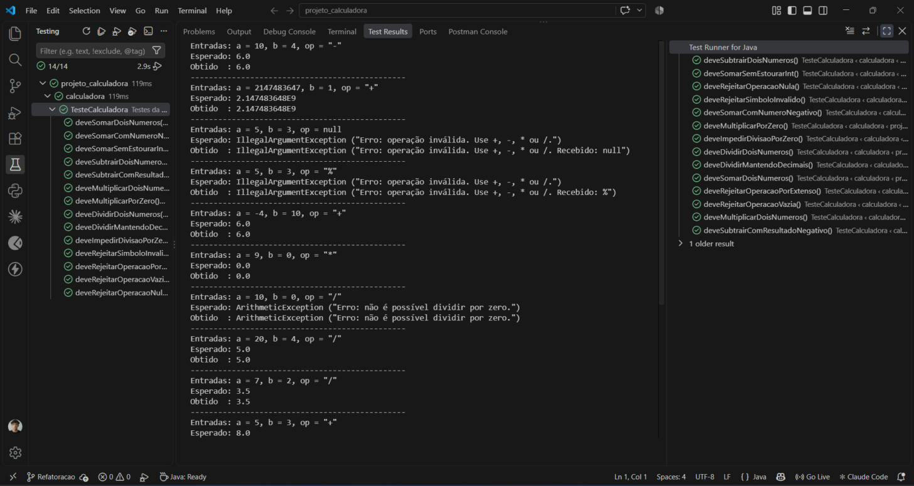
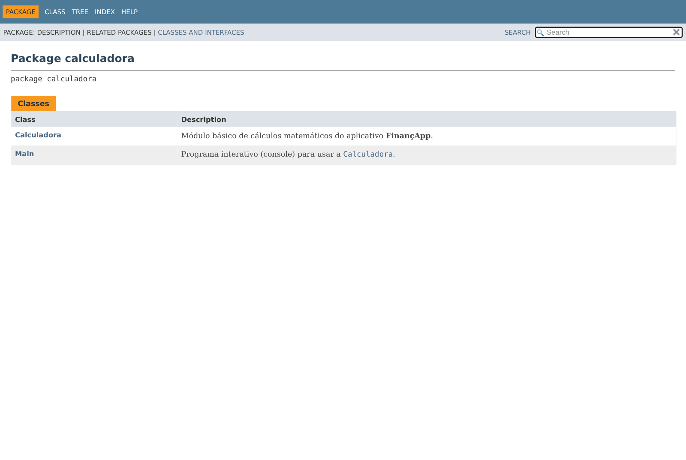
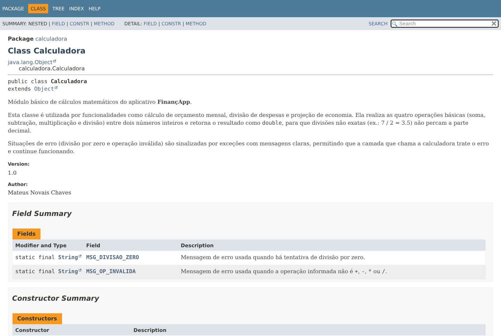
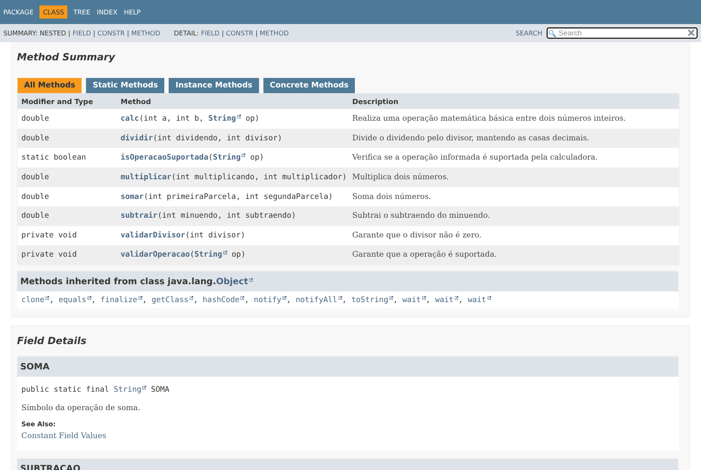

# Projeto Calculadora — FinançApp

> Projeto acadêmico com foco em qualidade de software: testes, tratamento de erros, refatoração, documentação técnica e versionamento.

## 1. Identificação do Projeto

**Projeto:** projeto_calculadora
**Contexto:** FinançApp — aplicativo de controle de finanças pessoais (startup fictícia)
**Aluno:** Mateus Novais Chaves
**RA:** 251382
**Curso:** Análise e Desenvolvimento de Sistemas — Facens
**Disciplina:** _(preencher)_
**Professor:** _(preencher)_
**Semestre:** 2026.2

# 2. Visão Geral

Este projeto implementa, em Java, o módulo básico de cálculos matemáticos do FinançApp. O módulo será reutilizado em diferentes funcionalidades do aplicativo:

- Cálculo de orçamento mensal;
- Divisão de despesas;
- Projeção de economia financeira;
- Cálculos auxiliares do sistema.

Além da implementação, o projeto aplica práticas de qualidade de software:

- Testes unitários com JUnit 5;
- Tratamento de erros;
- Refatoração;
- Documentação com JavaDoc;
- Versionamento com Git e GitHub;
- Facilidade de manutenção.

# 3. Problema

A FinançApp precisa de um módulo de cálculos confiável, que será usado em várias partes do aplicativo. Um erro nesse módulo (por exemplo, uma divisão por zero que derruba o app) afetaria todo o sistema. Por isso, além de funcionar, o código precisa ter:

- Código legível e organizado;
- Testes automatizados;
- Tratamento de falhas;
- Documentação técnica;
- Controle de versão;
- Facilidade de manutenção.

# 4. Objetivo

## 4.1 Objetivo Geral

Desenvolver uma calculadora em Java aplicando práticas de qualidade de software: testes, tratamento de erros, refatoração, documentação e versionamento.

## 4.2 Objetivos Técnicos

- Implementar as operações de soma, subtração, multiplicação e divisão;
- Tratar entradas e operações inválidas;
- Impedir a divisão por zero;
- Criar testes unitários automatizados com JUnit;
- Refatorar o código sem alterar o comportamento;
- Documentar classes, atributos e métodos com JavaDoc;
- Gerar a documentação HTML na pasta `docs/`;
- Versionar o projeto com Git e GitHub;
- Organizar o histórico com commits descritivos e branches;
- Documentar o projeto neste README.

# 5. Escopo Funcional

| Código | Funcionalidade | Descrição | Status |
|---|---|---|:---:|
| RF01 | Soma | Soma dois números inteiros | ✅ |
| RF02 | Subtração | Subtrai dois números inteiros | ✅ |
| RF03 | Multiplicação | Multiplica dois números inteiros | ✅ |
| RF04 | Divisão | Divide dois números inteiros | ✅ |
| RF05 | Validação de divisão | Impede divisão por zero | ✅ |
| RF06 | Operação inválida | Trata operadores não suportados | ✅ |

# 6. Requisitos Não Funcionais

| Código | Requisito | Descrição | Como foi atendido |
|---|---|---|---|
| RNF01 | Qualidade | O código deve possuir organização e legibilidade | Nomes descritivos, métodos pequenos, indentação padronizada |
| RNF02 | Testabilidade | As operações devem possuir testes automatizados | 14 testes JUnit 5 em `TesteCalculadora` |
| RNF03 | Manutenção | O código deve permitir refatoração sem alteração funcional | Branch `Refatoracao`, com os mesmos testes passando |
| RNF04 | Documentação | Classes e métodos devem possuir JavaDoc | JavaDoc completo + HTML em `docs/` |
| RNF05 | Versionamento | O projeto deve utilizar Git e GitHub | Commits organizados, branches `main` e `Refatoracao` |
| RNF06 | Confiabilidade | Erros não devem interromper inesperadamente a execução | Exceções tratadas com `try/catch` no programa `Main` |

# 7. Tecnologias Utilizadas

| Tecnologia | Versão | Finalidade |
|---|---|---|
| Java | 17+ | Desenvolvimento |
| JDK | 17+ | Compilação |
| JUnit | 5.11.4 | Testes |
| Maven | 3.x | Download do JUnit e execução dos testes |
| Git | 2.x | Controle de versão |
| GitHub | — | Repositório remoto |
| JavaDoc | — | Documentação |
| IDE | IntelliJ IDEA / Eclipse / VS Code | Ambiente de desenvolvimento |

# 8. Estrutura do Projeto

```
projeto_calculadora/
├── src/
│   └── calculadora/
│       ├── Calculadora.java        # Classe com o método calc()
│       └── Main.java               # Programa interativo no console
├── test/
│   └── calculadora/
│       └── TesteCalculadora.java   # Testes unitários (JUnit 5)
├── docs/
│   └── index.html                  # Documentação JavaDoc
├── images/
│   ├── testes/
│   ├── javadoc/
│   └── refatoracao/
├── pom.xml                         # Configuração Maven (JUnit)
├── README.md
└── .gitignore
```

# 9. Operações

O método principal é `calc(int a, int b, String op)`. Ele recebe dois números inteiros e o símbolo da operação e retorna o resultado como `double`:

| Operação | Símbolo | Exemplo | Resultado |
|---|:---:|---|---|
| Soma | `+` | `calc(5, 3, "+")` | `8.0` |
| Subtração | `-` | `calc(10, 4, "-")` | `6.0` |
| Multiplicação | `*` | `calc(6, 7, "*")` | `42.0` |
| Divisão | `/` | `calc(7, 2, "/")` | `3.5` |

**Por que `double`?** Para que divisões não exatas mantenham as casas decimais. Por exemplo, dividir uma despesa de R$ 7 entre 2 pessoas dá R$ 3,50. Os números são convertidos para `double` antes da conta, o que também evita estouro de `int`: `2147483647 + 1` retorna `2147483648`, e não um número negativo.

# 10. Tratamento de Erros

| Situação | Exemplo | Comportamento |
|---|---|---|
| Divisão por zero | `calc(10, 0, "/")` | Lança `ArithmeticException`: *"Erro: não é possível dividir por zero."* |
| Operação inválida | `calc(5, 3, "%")`, `""` ou `null` | Lança `IllegalArgumentException`: *"Erro: operação inválida. Use +, -, * ou /."* |
| Texto no lugar de número (no `Main`) | `abc` | Exibe *"Erro: digite apenas números inteiros."* |

No programa `Main`, essas exceções são capturadas com `try/catch`. A mensagem é exibida e o programa **continua funcionando** até o usuário digitar `sair`.



# 11. Testes

Os testes ficam em `test/calculadora/TesteCalculadora.java` e usam **JUnit 5**. São 14 testes:

| Grupo | Testes | Entradas | Esperado |
|---|---|---|---|
| Soma | 3 | `5 + 3`, `-4 + 10`, `2147483647 + 1` | `8`, `6`, `2147483648` |
| Subtração | 2 | `10 - 4`, `3 - 8` | `6`, `-5` |
| Multiplicação | 2 | `6 * 7`, `9 * 0` | `42`, `0` |
| Divisão | 2 | `20 / 4`, `7 / 2` | `5`, `3.5` |
| Divisão por zero | 1 | `10 / 0` | `ArithmeticException` |
| Operações inválidas | 4 | `"%"`, `"soma"`, `""`, `null` | `IllegalArgumentException` |

Cada teste usa `assertEquals` ou `assertThrows` e também imprime no console as **entradas**, o **resultado esperado** e o **resultado obtido**.

### Execução dos testes



# 12. Refatoração

Depois da versão inicial (1.0), foi criada a branch `Refatoracao`, onde o código foi reorganizado **sem alterar o comportamento** (versão 2.0).

| Técnica | O que mudou |
|---|---|
| **Extração de métodos** | Cada operação ganhou um método próprio: `somar`, `subtrair`, `multiplicar` e `dividir`. As validações foram para `validarOperacao` e `validarDivisor`. No `Main`, o código que ficava todo dentro do `main` foi dividido em `exibirCabecalho`, `executarRodada`, `lerTexto` e `exibirResultado`. |
| **Simplificação de condicionais** | A cadeia de `if / else if` virou um `switch`, com a validação feita antes. |
| **Melhoria nos nomes de variáveis** | `r` → `resultado`, `sc` → `entrada`, `c` → `calculadora`, `x` → `primeiraEntrada`. Os parâmetros ganharam nomes como `dividendo`/`divisor` e `minuendo`/`subtraendo`. |
| **Legibilidade e organização** | Os símbolos viraram constantes (`SOMA`, `SUBTRACAO`, `MULTIPLICACAO`, `DIVISAO`), e as operações aceitas ficaram em `OPERACOES_SUPORTADAS`. |



### Testes após a refatoração

Os **mesmos 14 testes JUnit** foram executados novamente na branch `Refatoracao`, sem nenhuma alteração na classe de testes, e todos passaram. O funcionamento do sistema permaneceu correto.



# 13. Documentação JavaDoc

A documentação foi gerada com JavaDoc e está em [`docs/index.html`](docs/index.html). Estão documentados classes, atributos, construtores, métodos, parâmetros (`@param`), retornos (`@return`), exceções (`@throws`), autor (`@author`) e versão (`@version`).



Classe `Calculadora` na versão 1.0:



Métodos da classe `Calculadora` na versão 2.0, após a refatoração:



# 14. Como Executar

**Na IDE (recomendado):** abra a pasta do projeto no IntelliJ, Eclipse ou VS Code. A IDE reconhece o `pom.xml` e baixa o JUnit automaticamente. Depois:
- clique com o botão direito em `TesteCalculadora.java` → **Run** para executar os testes;
- clique com o botão direito em `Main.java` → **Run** para usar a calculadora.

**Pelo terminal (com Maven instalado):**

```bash
mvn test                                    # executa os testes JUnit
mvn compile                                 # compila o projeto
java -cp target/classes calculadora.Main    # executa a calculadora
```

**Gerar a documentação JavaDoc:**

```bash
javadoc -d docs -sourcepath src -subpackages calculadora -private -author -version -encoding UTF-8 -docencoding UTF-8 -charset UTF-8
```

# 15. Versionamento

| Branch | Conteúdo |
|---|---|
| `main` | Branch principal. Recebeu a versão inicial (1.0) e, ao final, o merge da refatoração |
| `Refatoracao` | Código reorganizado com técnicas de refatoração (versão 2.0) |

Os commits seguem prefixos que indicam o tipo de alteração: `feat` (funcionalidade), `fix` (correção), `test` (testes), `docs` (documentação), `refactor` (refatoração) e `chore` (configuração).

# 16. Link do Repositório

https://github.com/mateusnchaves/projeto_calculadora
